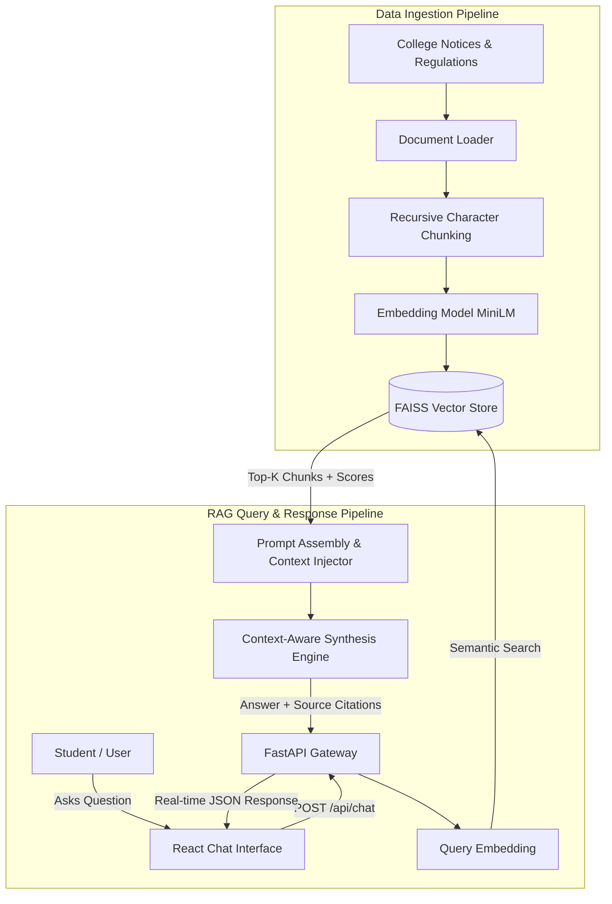

# 🎓 AI-Powered College FAQ Chatbot (RAG Assistant)

[](https://python.org)
[](https://fastapi.tiangolo.com)
[](https://langchain.com)
[](https://github.com/facebookresearch/faiss)
[](https://react.dev)

An intelligent, context-aware college assistant that answers student inquiries by retrieving pertinent information from college notices, academic regulations, examination policies, fee schedules, and campus FAQs using **Retrieval-Augmented Generation (RAG)**.

---

## 🌟 Key Highlights & Features

- 🏛️ **College RAG Pipeline:** Retrieves verified information from official notices, grading regulations, attendance policies, and hostel rules to eliminate LLM hallucinations.
- 📑 **Document Processing Pipeline:** Automated text extraction, recursive character chunking with sliding overlap, embedding generation, semantic similarity indexing, and context synthesis.
- ⚡ **High-Speed Vector Search:** Powered by **FAISS** (Facebook AI Similarity Search) with cosine similarity ranking and dynamic confidence scoring.
- 💬 **Interactive React UI:** Responsive chat interface featuring conversation history, source citation expanders (with passage matching scores), real-time response metrics, and categorized quick-suggestion chips.
- 🚀 **FastAPI Backend:** Fully asynchronous REST API with Swagger documentation (`/docs`), health telemetry, document management, and live re-indexing endpoints.

---

## 🏗️ System Architecture



---

## 📂 Project Structure

```text
├── backend/
│   ├── app.py                 # FastAPI application & REST endpoints
│   ├── config.py              # Configuration & hyperparameters
│   ├── document_processor.py  # Text extraction & recursive chunker
│   ├── rag_engine.py          # Context assembler, history & QA engine
│   └── vector_store.py        # FAISS vector store & embedding engine
├── data/
│   ├── college_docs/          # Official knowledge base documents
│   │   ├── academic_regulations.txt
│   │   ├── admissions_and_fees.txt
│   │   ├── campus_and_hostels.txt
│   │   ├── examination_guidelines.txt
│   │   └── placement_and_training.txt
│   └── vector_index/          # Persisted FAISS index & metadata
├── frontend/
│   └── index.html             # React chat interface with source citations
├── tests/
│   └── test_rag.py            # Automated pipeline test suite
├── requirements.txt           # Python dependencies
├── run.py                     # One-click server launcher
├── .gitignore                 # Git ignore specifications
└── README.md                  # Project documentation
```

---

## 🚀 Getting Started

### 1. Prerequisites
- Python 3.10+ installed on your system.

### 2. Installation
Clone the repository and install the required dependencies:

```bash
git clone https://github.com/kayalapraneeth30/ai-college-faq-chatbot.git
cd ai-college-faq-chatbot
pip install -r requirements.txt
```

### 3. Run the Application
Start the full-stack server using the unified runner script:

```bash
python run.py
```

- **Web Application:** [http://127.0.0.1:8000](http://127.0.0.1:8000)
- **Interactive API Docs (Swagger):** [http://127.0.0.1:8000/docs](http://127.0.0.1:8000/docs)

---

## 🧪 Running Automated Tests

Run the included verification suite to test chunking, vector indexing, and RAG retrieval accuracy:

```bash
python tests/test_rag.py
```

---

## 📡 API Endpoints

| Method | Endpoint | Description |
| :--- | :--- | :--- |
| `POST` | `/api/chat` | Send a query and receive a synthesized answer with source citations |
| `GET` | `/api/documents` | List all indexed college documents and chunk statistics |
| `POST` | `/api/reindex` | Trigger automated re-chunking and FAISS vector index rebuilding |
| `GET` | `/api/faqs` | Fetch popular categorized campus FAQ questions |
| `GET` | `/api/health` | Service health status and vector store diagnostics |
| `POST` | `/api/clear-session` | Clear conversation history for a given session |

---

## 👤 Author
**Praneeth Kayala**  
- GitHub: [@kayalapraneeth30](https://github.com/kayalapraneeth30)
